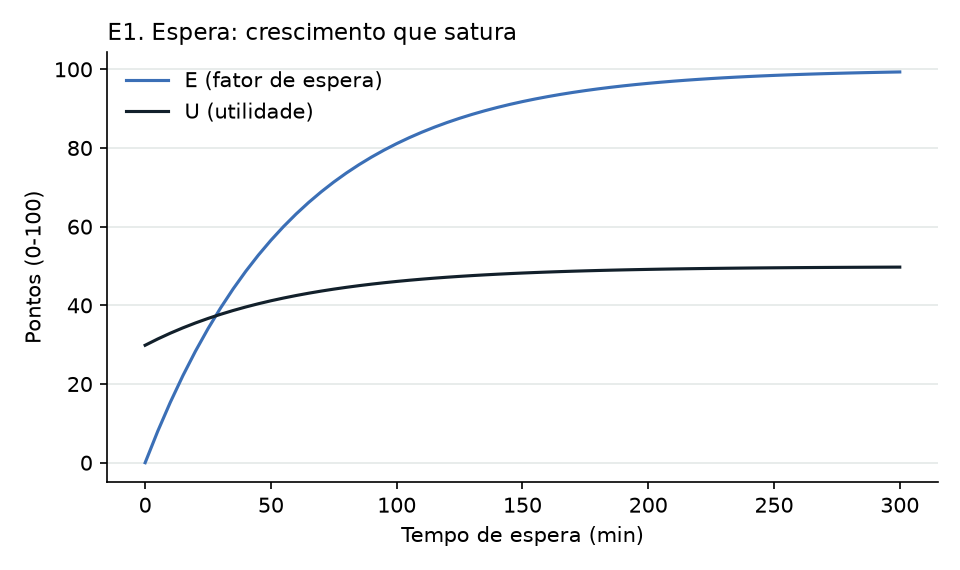
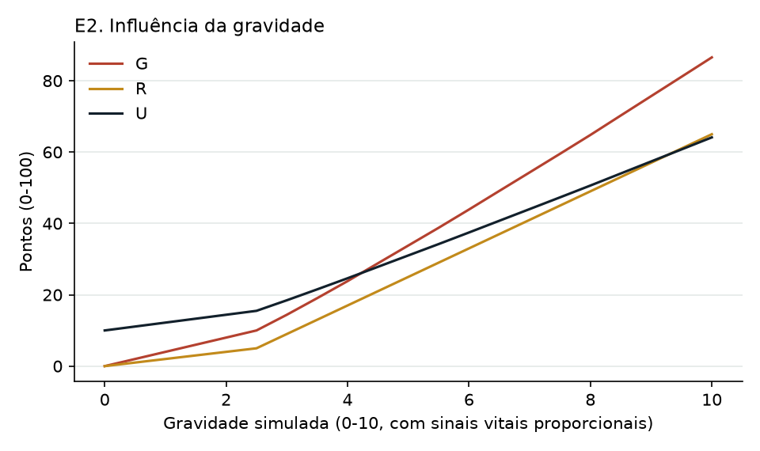
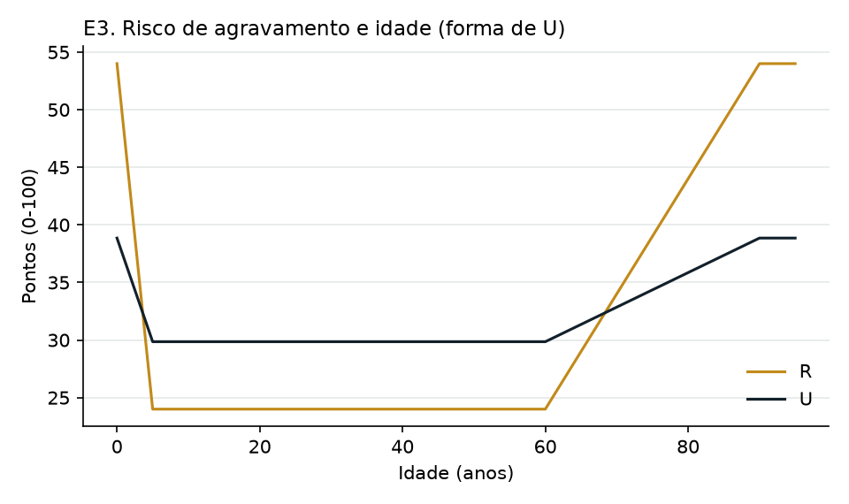
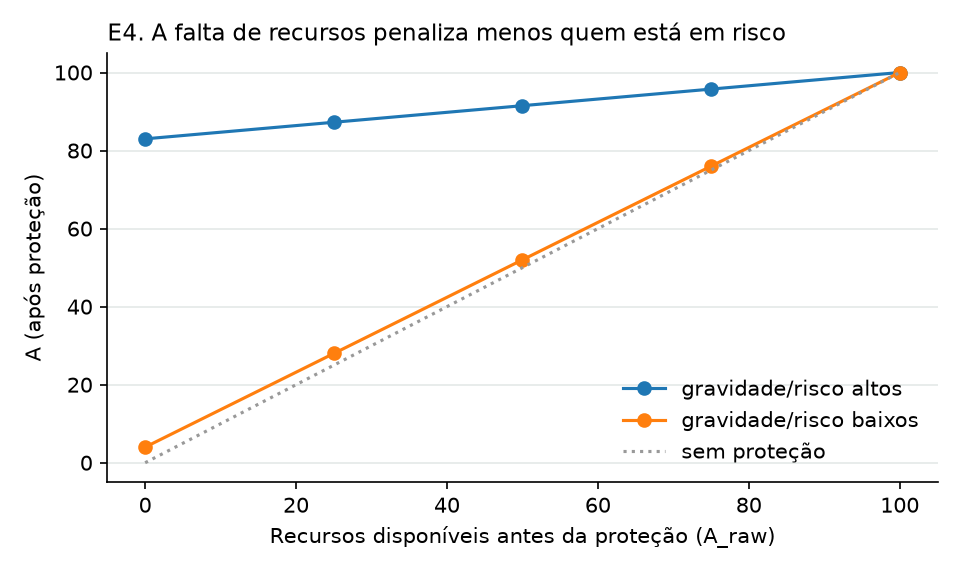
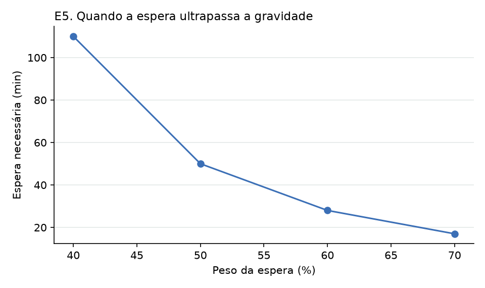
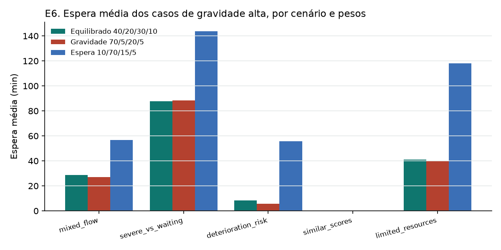

# Relatório de experiências do agente baseado em utilidade

Gerado por `python -m scripts.run_experiments` (seeds [1, 2, 3, 4, 5], 40 pacientes por simulação, 480 min).
Todos os dados são sintéticos e os parâmetros são experimentais: **estes resultados descrevem o comportamento do agente
e não constituem validação clínica.**

Função: `U = (w1·G + w2·E + w3·R + w4·A) / Σw`, pesos de referência 40/20/30/10.

## E1. Como a pontuação muda quando o tempo de espera aumenta

Paciente de referência (40 anos, sinais moderados, sintoma 5/10), espera de 0 a 300 min.

Com τ = 60 min, uma hora de espera dá E = 63.2 e a utilidade passa a 42.5; aos 300 min, E = 99.3
(satura abaixo de 100). Como w2 = 20%, a espera contribui no máximo com 20 pontos.

## E2. Como a gravidade influencia a utilidade

Varia-se a severidade simulada de 0 a 10 com sinais vitais proporcionais (normais → críticos).

G sobe de 0.0 para 86.5 e U de 10.0 para 64.1. A gravidade também alimenta R, por isso o efeito
total sobre U é maior do que o do peso w1 isolado.

## E3. Como o risco de agravamento influencia a ordenação

Mesmos sinais e sintomas, idades de 0 a 95 anos.

R = 54.0 aos 0 anos, 24.0 aos 35 e 54.0 aos 90: crianças pequenas e idosos sobem na fila
em relação a adultos com os mesmos sinais (U = 38.9 / 29.9 / 38.9).

## E4. Como os recursos afetam as decisões

Paciente que precisa de 4 unidades; 0 a 4 livres. Compara-se um perfil de baixo risco com um de alto risco.

| perfil | unidades_livres_de_4 | A_raw | A | U |
|---|---|---|---|---|
| gravidade/risco baixos | 0 | 0.0 | 4.0 | 2.6 |
| gravidade/risco baixos | 1 | 25.0 | 28.0 | 5.0 |
| gravidade/risco baixos | 2 | 50.0 | 52.0 | 7.4 |
| gravidade/risco baixos | 3 | 75.0 | 76.0 | 9.8 |
| gravidade/risco baixos | 4 | 100.0 | 100.0 | 12.2 |
| gravidade/risco altos | 0 | 0.0 | 83.0 | 66.2 |
| gravidade/risco altos | 1 | 25.0 | 87.2 | 66.6 |
| gravidade/risco altos | 2 | 50.0 | 91.5 | 67.1 |
| gravidade/risco altos | 3 | 75.0 | 95.8 | 67.5 |
| gravidade/risco altos | 4 | 100.0 | 100.0 | 67.9 |

Sem nenhuma unidade livre, o perfil de baixo risco fica com A = 4.0 e o de alto risco com A = 83.0:
a proteção impede que a falta de recursos reduza a prioridade de quem está em risco.

## E5. Quando a espera ultrapassa a gravidade (sensibilidade aos pesos)

Um paciente leve que espera há t minutos contra um paciente grave que acabou de chegar. Mostra-se a espera necessária
para o leve passar à frente, em função do peso da espera.

| peso_espera_% | peso_gravidade_% | espera_para_ultrapassar_min |
|---|---|---|
| 5 | 43 | n/d |
| 10 | 40 | n/d |
| 20 | 36 | n/d |
| 30 | 32 | n/d |
| 40 | 27 | 110 |
| 50 | 22 | 50 |
| 60 | 18 | 28 |
| 70 | 14 | 17 |

Com o peso da espera a 20% o paciente leve nunca ultrapassa o grave (testado até 3000 min) (referência); com o peso da espera a 60% o paciente leve ultrapassa o grave após 28 min.
Este é o mecanismo que impede a espera isolada de superar a gravidade, e que o ecrã do agente sinaliza quando w2 ≥ w1.

## E6. Cenários e configurações de pesos

Média de 5 seed(s). Esperas em minutos de tempo simulado.

| cenario | pesos | atendidos | espera_media | espera_alta | espera_baixa | espera_max |
|---|---|---|---|---|---|---|
| mixed_flow | Equilibrado 40/20/30/10 | 40.0 | 113.1 | 28.6 | 186.2 | 334.1 |
| mixed_flow | Gravidade 70/5/20/5 | 40.0 | 114.3 | 27.0 | 189.9 | 366.0 |
| mixed_flow | Espera 10/70/15/5 | 40.0 | 97.1 | 56.6 | 131.6 | 247.4 |
| severe_vs_waiting | Equilibrado 40/20/30/10 | 40.0 | 114.6 | 87.8 | 390.9 | 399.3 |
| severe_vs_waiting | Gravidade 70/5/20/5 | 40.0 | 112.4 | 88.4 | 391.6 | 399.7 |
| severe_vs_waiting | Espera 10/70/15/5 | 40.0 | 98.6 | 143.9 | 126.0 | 283.6 |
| deterioration_risk | Equilibrado 40/20/30/10 | 40.0 | 117.1 | 8.5 | 201.4 | 340.1 |
| deterioration_risk | Gravidade 70/5/20/5 | 40.0 | 117.4 | 5.7 | 204.9 | 342.1 |
| deterioration_risk | Espera 10/70/15/5 | 40.0 | 104.3 | 55.6 | 142.0 | 273.6 |
| similar_scores | Equilibrado 40/20/30/10 | 39.4 | 189.8 | n/d | 279.6 | 442.8 |
| similar_scores | Gravidade 70/5/20/5 | 39.4 | 190.1 | n/d | 301.0 | 455.3 |
| similar_scores | Espera 10/70/15/5 | 39.4 | 190.1 | n/d | 219.7 | 419.5 |
| limited_resources | Equilibrado 40/20/30/10 | 17.0 | 129.1 | 41.0 | 129.1 | 355.1 |
| limited_resources | Gravidade 70/5/20/5 | 17.4 | 131.7 | 39.8 | 118.3 | 341.4 |
| limited_resources | Espera 10/70/15/5 | 18.0 | 138.7 | 118.0 | 116.7 | 315.3 |

Face ao perfil equilibrado, e em média nos cenários com dados: o perfil «Espera» altera a espera dos casos de gravidade alta em +52.1 min e a dos de gravidade baixa em -90.2 min; o perfil «Gravidade» altera-as em -1.2 min e +3.7 min. Os pesos de referência já são dominados pela gravidade, por isso reforçá-los muda pouco; o que altera os resultados é dar à espera um peso comparável ao da gravidade (ver E5).
"n/d" significa que o cenário não tem pacientes desse grupo de gravidade (por exemplo, `similar_scores` só tem casos moderados).

## Reprodutibilidade

Mesma seed e mesma configuração produzem exatamente as mesmas métricas: **confirmado**.
