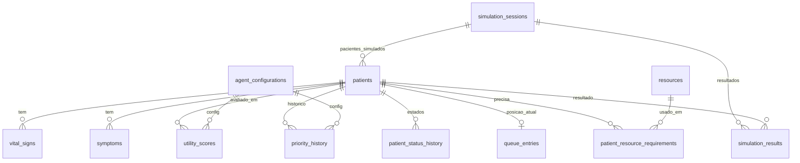

# Documentação técnica: arquitetura

Projeto académico com dados sintéticos. Nada aqui tem validade clínica.

## 1. Visão geral

```
Next.js (UI, sem lógica de decisão)
        │  REST/JSON
        ▼
FastAPI (app/api)  ── valida com Pydantic (app/schemas)
        │
        ▼
Serviços (app/services)                        Agente (app/agents) — puro, sem BD
  patient_service   estado e persistência        UtilityAgent.run_cycle():
  priority_service  fila, histórico, ações   ──►   perceive → process → evaluate → select
  config_service    pesos versionados
  resource_service  recursos
  simulation_service sessões (SimPy)             utility_service: fórmulas e explicação
  statistics_service dashboard
        │
        ▼
SQLAlchemy ORM (app/models) ──► MySQL
```

Regras de dependência: o agente não importa nada de `api`, `models` nem `database`. O tempo entra sempre por um
`Clock` injetável, o que torna a ordenação determinística e testável.

## 2. Ciclo de decisão

| Etapa | Onde | O que faz |
|---|---|---|
| Perceção | `UtilityAgent.perceive` | Recebe pacientes em espera, unidades livres de cada recurso e o instante. Remove duplicados. |
| Processamento | `UtilityAgent.process` + `utility_service.compute_factors` | Calcula G, E, R, A (0..100) e valores intermédios. |
| Avaliação | `UtilityAgent.evaluate` | Aplica pesos normalizados, calcula U, contributos e faixa de prioridade. |
| Seleção | `UtilityAgent.rank/select` | Ordena (desempate determinístico) e escolhe o próximo paciente atendível com os recursos livres, via heap. |
| Ação | `PriorityService._persist` | Grava `queue_entries`, `utility_scores`, `priority_history`; `call_next` altera estado e recursos. |
| Reavaliação | `PriorityService.recalculate` | Corre um novo ciclo em cada evento: novo paciente, atualização, estado, recursos, pesos, passagem do tempo. |

`GET /queue` reavalia no momento da leitura (a espera depende do relógio). Só grava um novo snapshot se a ordem ou a
configuração mudaram.

## 3. Fórmula

```
U(p) = (w1·G + w2·E + w3·R + w4·A) / (w1 + w2 + w3 + w4)        G, E, R, A em [0, 100]
G = a·V + (1−a)·S        V = m·max(dᵢ) + (1−m)·média(dᵢ)        S = 10·severidade máxima dos sintomas
E = 100·(1 − e^(−t/τ))
R = (r1·max(dᵢ) + r2·F_idade + r3·S) / (r1+r2+r3)
A = A_raw + (100 − A_raw)·max(G, R)/100
```

| Símbolo | Significado | Valor por defeito | Justificação |
|---|---|---|---|
| dᵢ | Desvio do sinal vital i face ao intervalo de referência (0..100) | intervalos em `domain.py` | Normaliza unidades diferentes para a mesma escala |
| a | Peso dos sinais vitais na gravidade | 0,6 | Sinais objetivos pesam mais que a severidade simulada |
| m | Peso do pior sinal vs. média | 0,5 | Um único sinal muito alterado deve contar |
| τ | Constante de tempo da espera | 60 min | E ≈ 63 após 1 h; satura |
| F_idade | Forma de U: 100 aos 0 anos, 0 aos 5; 0 até 60, 100 aos 90 | ver `AgentParams` | Crianças pequenas e idosos têm mais risco de agravamento (parâmetro experimental) |
| r1, r2, r3 | 0,5 / 0,3 / 0,2 | | Sinais críticos dominam, idade e sintomas complementam |
| w1..w4 | 40 / 20 / 30 / 10 | | Exemplo do enunciado; configuráveis e normalizados pela soma |

Propriedades garantidas por testes (`tests/test_utility_function.py`): fatores sempre em 0..100; E monótona e
saturada; contributos somam U; pesos normalizados; a espera não supera uma grande diferença de gravidade com os pesos
de referência; a falta de recursos penaliza menos quem tem G ou R altos; desempate determinístico; mesma entrada dá a
mesma saída em qualquer ordem de chegada dos dados.

## 4. Modelo de dados (MySQL)



Tabelas: `patients`, `vital_signs`, `symptoms`, `utility_scores`, `priority_history`, `resources`,
`simulation_sessions`, `simulation_results` (do enunciado) e `agent_configurations`, `patient_resource_requirements`,
`patient_status_history`, `queue_entries` (acrescentadas) e a coluna `patients.service_minutes` (migração `0002`). Chaves estrangeiras com `ON DELETE CASCADE`.

Ciclo de vida dos recursos: ocupados em `call-next` (estado `in_service`) e libertados quando o atendimento termina
(duração prevista em `patients.service_minutes`, `PUT` com `status`, ou `advance-time`). Ver `docs/FUNCIONAMENTO.md`.

Convenções: datas em UTC sem fuso; `resources.quantity_available` é a capacidade e `quantity_in_use` as unidades
ocupadas; `patients.session_id` nulo = fila real, preenchido = paciente de uma sessão de simulação.

## 4.1 Unidades e intervalos de validação

| Campo | Unidade | Intervalo aceite |
|---|---|---|
| age | anos | 0 a 120 |
| temperature | °C | 30 a 45 |
| heart_rate | bpm | 20 a 250 |
| oxygen_saturation | % | 50 a 100 |
| respiratory_rate | rpm | 4 a 70 |
| systolic_pressure / diastolic_pressure | mmHg | 50 a 260 / 30 a 160 (sistólica > diastólica) |
| simulated_severity | escala | 0 a 10 |

Valores ausentes são aceites (os sinais em falta não entram no cálculo e a explicação avisa); valores fora do
intervalo são rejeitados com 422.

## 5. API

Formato de erro único: `{"error": {"code", "message", "details"}}`. Documentação interativa em `/docs`.

| Grupo | Endpoints |
|---|---|
| Pacientes | `POST/GET /patients`, `GET/PUT/DELETE /patients/{id}` (campos `service_minutes`, `service_remaining_minutes`) |
| Agente | `POST /agent/evaluate` (sem persistir; cenários "e se"), `GET /agent/status`, `GET/PUT /agent/configuration`, `GET /agent/configuration/history`, `POST /agent/recalculate` |
| Fila | `GET /queue`, `GET /queue/{patient_id}`, `POST /queue/recalculate`, `GET /queue/history`, `POST /queue/call-next` |
| Recursos | `GET/POST /resources`, `PUT /resources/{id}` |
| Simulação | `GET /simulation/scenarios`, `POST /simulation/start`, `POST /simulation/compare`, `GET /simulation/sessions[/{id}[/results]]`, `POST /simulation/generate`, `POST /simulation/advance-time` |
| Estatísticas | `GET /statistics/dashboard`, `/priority-distribution`, `/utility-evolution` |

## 6. Simulação

Motor SimPy (`app/simulation/engine.py`) com relógio virtual. Em cada chegada ou fim de atendimento, o agente corre um
ciclo e chama os pacientes atendíveis. Os pacientes são gerados por perfis (`generators.py`) com uma seed, e os
cenários (`scenarios.py`) definem chegadas e capacidade. Mesma seed e mesma configuração dão as mesmas métricas.

## 7. Cobertura dos requisitos de qualidade

| Requisito | Onde |
|---|---|
| Código modular, separação de responsabilidades | estrutura de pastas acima |
| Validação no backend, tratamento de erros | `schemas/`, `core/errors.py` |
| Configuração por variáveis de ambiente | `core/config.py`, `.env.example` |
| Swagger/OpenAPI | `/docs` |
| Testes da função de utilidade | `tests/test_utility_function.py` |
| Testes da gestão da fila | `tests/test_priority_queue.py` |
| Testes de integração (API, SQLite) | `tests/test_api.py` |
| Testes de integração com MySQL | `tests/test_integration_mysql.py` (com `TEST_MYSQL_URL`) e a suite completa também corre em MySQL com essa variável |
| Histórico de decisões e explicação | `priority_history`, `utility_scores.calculation_details`, `/queue/{id}` |
| Pesos configuráveis e versionados | `agent_configurations`, `PUT /agent/configuration` |
| Dados sintéticos | `simulation/generators.py` |
| Experiências e gráficos | `scripts/run_experiments.py` → `backend/reports/` |

## 8. Limitações conhecidas

- Sem autenticação nem controlo de acessos.
- Parâmetros clínicos (intervalos, idade) são experimentais, não protocolos validados.
- O recálculo é completo a cada evento (adequado para centenas de pacientes, não para milhares).